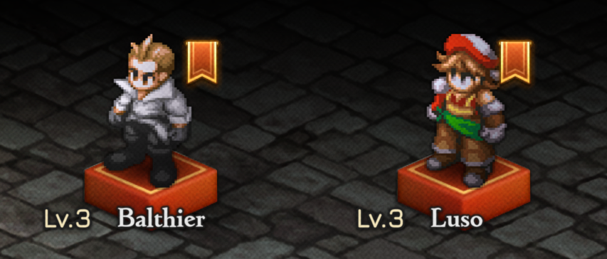
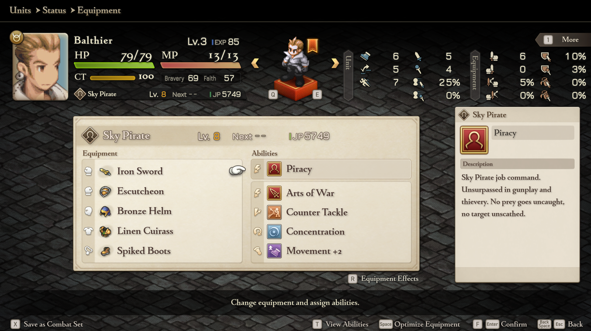

# WotL Restoration

A [Reloaded-II](https://github.com/Reloaded-Project/Reloaded-II) mod for **FINAL FANTASY TACTICS - The Ivalice Chronicles** (Steam, enhanced mode) that brings back the characters, items and story scenes from *War of the Lions*.



## What it restores

The Ivalice Chronicles executable still has a lot of War of the Lions data, such as the event setup records for events 512–599, their casts, and WotL's item code and tables. What it doesn't have is what makes those records play: scripts, text, triggers, battle rules, some art, and the table rows the enhanced UI needs. This mod supplies them.

- **Every WotL-only story scene** (events 512–581), each triggered by WotL's own conditions. These include:
  - Agrias's Birthday (with WotL's Tynar Rouge) and Agrias visiting Ovelia
  - Delita and Ovelia at Zeirchele Falls and at Bervenia
  - Wiegraf mourning Milleuda as Loffrey recruits him
  - Ovelia's prayer and the assassins at Zeltennia's chapel ruins
  - Argath's return at Limberry
  - Cletienne and Meliadoul at Dorter
  - Beowulf and Reis against Celebrant Bremondt
  - Agrias and Orlandeau against the Northern Sky deserters
  - Balthier's and Luso's battles and recruitment
- **Four tavern rumors**: the Rash of Thefts, A Call for Guards, Disorder in the Order and Lionel's New Liege Lord. They unlock Balthier, Beowulf and Reis, and the Deserters battle.
- **WotL's characters as proper units**: names, jobs, job commands, sprite shapes and portraits for Balthier, Luso, Argath the Deathknight, Aliste, Bremondt and the Dark Dragon.
- **All 40 WotL items**, with their original ids, names, icons and effects.
- **Map 127** (Limberry Castle Inner Court), a battle surface on a map that only had cutscenes, and a 4-stage version of the Limberry battle minimap.



## Installation

1. Install [Reloaded-II](https://github.com/Reloaded-Project/Reloaded-II) and add `FFT_enhanced.exe`.
2. Download the latest release and drag the archive into Reloaded-II, or extract it into `Reloaded-II/Mods/`.
3. Enable **WotL Restoration**. Reloaded-II downloads its dependencies automatically, including [fftivc.utility.modloader](https://github.com/Nenkai/fftivc.utility.modloader).

## Repository layout

| Path | Contents |
|---|---|
| `*.cs` | The mod DLL. It patches only what the data files can't reach: portrait tables, the monster palette pointer, rumor town masks, event setup records, the item table expansion (`ItemExpansion.cs`) and the birthday reward (`AgriasBirthday.cs`). `*.g.cs` files are generated by `tools/`. |
| `Template/` | Reloaded-II mod template boilerplate. |
| `FFTIVC/data/enhanced/` | The files fftivc.utility.modloader serves in place of the game's: event scripts, scenario text, nxd tables, event sprite sheets, portraits, item icons, map 127 and the battle minimap UI. |
| `FFTIVC/tables/enhanced/` | `JobData.xml` edits for the WotL jobs. |
| `tools/` | Python build pipeline that converts the WotL data and regenerates everything in `FFTIVC/`. |
| `research/` | Reverse-engineering notes (`NOTES.md`, `ITEM_EXPANSION.md`, `MAP_GRID_GUIDE.md`), the full internals guide (`WotL_Restoration_Guide.html`), WotL item and rumor data, and event sprite art. |
| `docs/images/` | Screenshots. |
| `ModConfig.json` | Reloaded-II mod manifest (id `WotLCharacters`). |
| `Publish.ps1`, `BuildLinked.ps1` | Reloaded-II packaging and local deploy scripts. |

For how the mod works, see [`research/WotL_Restoration_Guide.html`](research/WotL_Restoration_Guide.html). Download it and open it in a browser; GitHub shows HTML files as source.

## Building the DLL

You need the [.NET 9 SDK](https://dotnet.microsoft.com/download). Set `RELOADEDIIMODS` to your `Reloaded-II/Mods` folder, then run:

```powershell
dotnet build WotLCharacters.csproj      # builds into $env:RELOADEDIIMODS/fftivc.npcs.wotlcharacters
./Publish.ps1                           # release packages in Publish/ToUpload
```

`FFTIVC/` is committed, so building the DLL doesn't require the data pipeline. Pushing a tag runs the GitHub Actions workflow (`.github/workflows/reloaded.yml`), which builds the mod and attaches it to a GitHub release.

## Rebuilding the event data

`BuildLinked.ps1` runs `python tools/build_data.py` before publishing. It regenerates the scripts, text, nxd tables and textures in `FFTIVC/`. The pipeline reads game files that aren't in this repository, so you need to supply them:

| Input | Where the tools expect it |
|---|---|
| WotL PSP (USA) `TEST.EVT` | `research/TEST_wotl.EVT` |
| Lion War: ReMixed `TEST.EVT` and `ENTD4.ENT` (Agrias's Birthday source) | `research/TEST_remixed.EVT`, `research/ENTD4_remixed.ENT` |
| Vanilla IC nxd tables, scripts and UI parts | `research/vanilla/{nxd,script,ui,fftpack}/` |
| [FF16Tools.CLI](https://github.com/Nenkai/FF16Tools) | `FF16TOOLS` in `tools/build_data.py` and `tools/item_icons.py` |
| Extracted IC game files (minimap UIB) | `GAME` in `tools/continuous_map.py` |
| `FFT_enhanced.exe` (to regenerate `ItemSites.g.cs`) | `EXE` in `tools/item_sites.py` |

The tools need Python 3 and, for `item_sites.py`, `capstone`. Intermediate files go to `build/`, which git ignores.

## Credits

- **Spikedrose**: event sprite sheets and item icons, from *FF Tactics Mobile Sprites* (fftivc.texture.mobilesprites). Used and redistributed with permission. See [`research/art/README.md`](research/art/README.md).
- **Nyzer**: Lion War: ReMixed's port of Agrias's Birthday to the PSX game, which this mod's version is converted from.
- **Nenkai**: fftivc.utility.modloader and FF16Tools.
- The **FFHacktics** Discord.
